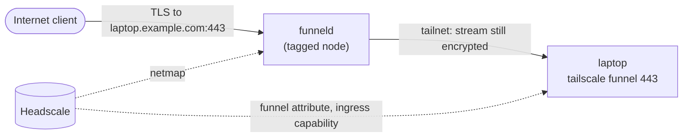

# Funnel

[Tailscale Funnel](https://tailscale.com/docs/features/tailscale-funnel) publishes a service running on a node to the
internet with `tailscale funnel`. Tailscale runs the public ingress servers for its own tailnets; with Headscale, the
operator runs them. Headscale itself exposes nothing: it only tells nodes they may funnel and tells the relays which
nodes they may reach.

A **relay** is an ordinary tailnet node running `funneld`. It accepts TLS connections from the internet, reads the server
name of each one without decrypting it, and hands the stream to the node of that name. The node terminates TLS with its
own certificate and checks that it funnels that name and port. The relay never sees the content.



## Requirements

- [Node certificates](dns.md) (`dns.certificates.enabled`): a funnel node terminates TLS with the certificate it gets
  for its MagicDNS name, so `dns.base_domain` must be a public domain, such as a subdomain set aside for the tailnet.
  This is how Tailscale works too: its MagicDNS names live under the public `ts.net`.
- Public DNS records pointing the names of the funnel nodes, `<node>.<base_domain>`, to the relay. Inside the tailnet,
  MagicDNS keeps answering with the nodes' tailnet addresses; only the funnel nodes need public records.
- A host for the relay that the internet reaches on the funnel ports.

## Configuration

Enable funnel and name the tag of the relays:

```yaml title="config.yaml"
funnel:
  enabled: true
  # Public ports nodes may funnel on; the relay listens on them.
  ports: [443, 8443, 10000]
  relay_tags: [tag:funnel-relay]
```

Give the `funnel` attribute to the nodes allowed to funnel, and declare the relay tag, in the [policy](policy.md):

```json
{
  "tagOwners": {
    "tag:funnel-relay": ["alice@"]
  },
  "nodeAttrs": [
    { "target": ["alice@"], "attr": ["funnel"] }
  ]
}
```

Headscale then sends those nodes the `funnel` attribute and the ports they may use, and grants nodes tagged
`tag:funnel-relay` the ingress capability towards them. That grant also makes the relays and the funnel nodes peers, so
the ACLs need no rule between them. Without `funnel.enabled`, the `funnel` attribute is ignored and Headscale logs a
warning when it loads the policy.

## Running the relay

`funneld` joins the tailnet in one of two ways.

=== "Embedded node"

    The relay runs its own node. Create a pre-authenticated key with the relay tag, then:

    ```console
    TS_AUTHKEY=<key> funneld -login-server https://headscale.example.com -ports 443,8443 -state-dir /var/lib/funneld
    ```

=== "Local tailscaled"

    The relay uses the `tailscaled` already running on the machine, which must carry the relay tag:

    ```console
    funneld -local -ports 443,8443
    ```

Then publish a service from a node allowed to funnel:

```console
tailscale funnel 3000
```

### Behind an SNI proxy

When another server already listens on port 443 of the relay host, put a proxy that routes connections by server name,
without terminating TLS, in front of both, and give `funneld` a local address for public port 443 with `PORT=ADDR`:

```console
funneld -local -ports 443=127.0.0.1:8443 -proxy-protocol-from 127.0.0.1
```

`-proxy-protocol-from` makes the proxy pass the client address with the PROXY protocol: connections from the listed
addresses or CIDR ranges must start with a PROXY header, and connections from anywhere else are dropped. Without it,
nodes see the proxy's address as the client's.

With Nginx:

```nginx
stream {
    map $ssl_preread_server_name $backend {
        ~\.ts\.example\.com$  127.0.0.1:8443;   # funnel nodes, to funneld
        default              127.0.0.1:4443;   # everything else
    }

    server {
        listen 443;
        ssl_preread on;
        proxy_pass $backend;
        proxy_protocol on;   # funneld -proxy-protocol-from 127.0.0.1; the default backend must accept it too
    }
}
```

### Behind a reverse proxy that terminates TLS

A reverse proxy that only proxies HTTP, such as Nginx Proxy Manager, cannot pass TLS through. It can still front the
relay, so that only the proxy is exposed: it terminates the client's TLS with its own certificate, then opens a new TLS
connection to `funneld` named after the requested host, which the node terminates with its own certificate. `funneld`
then needs no public port:

```console
funneld -login-server https://headscale.example.com -listen 127.0.0.1 -ports 443
```

```nginx
server {
    listen 443 ssl;
    server_name *.ts.example.com;
    # A certificate for *.ts.example.com.

    location / {
        proxy_pass https://127.0.0.1:443;
        proxy_ssl_server_name on;   # send the requested host as server name,
        proxy_ssl_name $host;       # or funneld cannot tell which node it is for
        proxy_set_header Host $host;
    }
}
```

In Nginx Proxy Manager, forward the proxy host to `funneld` with the `https` scheme and put the two `proxy_ssl_*` lines
in its advanced configuration.

The proxy sees the traffic in clear between the two connections, and nodes see the proxy's address as the client's.

## Limitations

- Behind an SNI proxy without `-proxy-protocol-from`, nodes see the proxy's address as the client's.
- Only TLS is relayed: `tailscale funnel` with `--tcp` is not supported.
- Custom domains for funnel are not supported.
